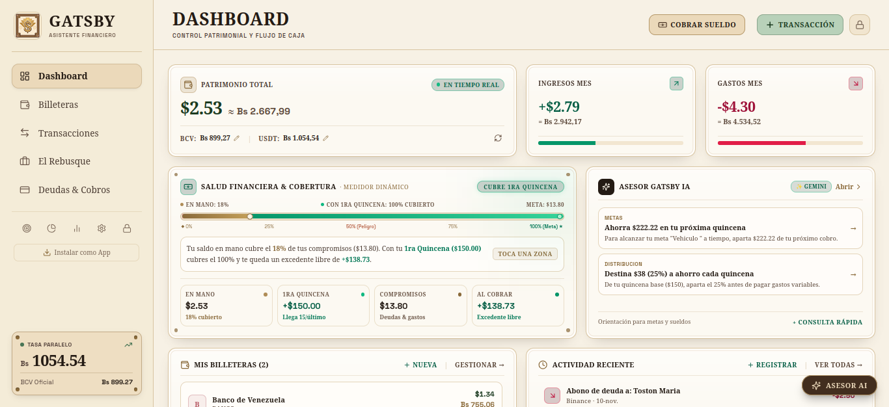
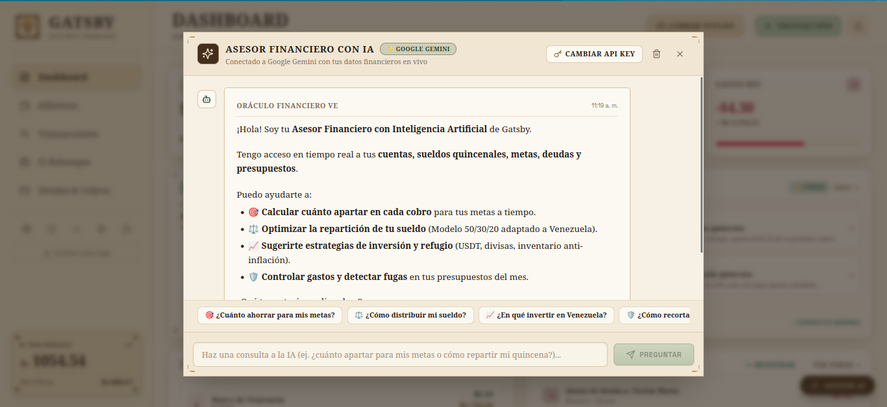

# 🍸 Gatsby — Intelligent Dual-Currency Financial Platform

> **An enterprise-grade personal finance operating system tailored for volatile multi-currency economies.**  
> Delivering real-time dual-ledger accounting, automated payroll dispersion, freelance cashflow modeling, and AI-driven wealth advisory.

---

> [!IMPORTANT]
> **Proprietary Software / Commercial Product — Source Code is Private.**  
> This showcase serves as a technical case study and architectural overview for portfolio evaluation. Available for private technical walkthroughs, system design discussions, or interactive demonstrations upon request.

---

## 🧭 Executive Summary: Problem & Solution

### The Challenge
Operating within high-inflation, dual-currency economic ecosystems (such as Venezuela's dual USD/VES market) presents unique computational and architectural challenges that standard financial tools (e.g., Mint, YNAB) fail to address:
- **Asymmetric Multi-Ledger Balances**: Individuals operate concurrently across domestic banking rails (instant mobile transfers, debit cards), international fintech protocols (Binance P2P, Zelle, PayPal), and physical cash in multiple currencies.
- **Dynamic FX Volatility & Spread Variance**: The purchasing power of domestic currency fluctuates daily against official central bank benchmarks (BCV) and parallel market rates, creating complex reconciliation bottlenecks.
- **Fragmented Income Streams**: Freelance service fees, multi-account wage allocations, and irregular receivables make real-time cashflow forecasting mathematically cumbersome.

### The Solution
**Gatsby** is a production-grade, full-stack Progressive Web App (PWA) designed from first principles to solve asymmetric dual-currency accounting. It serves as a unified financial ledger providing:
- **Automated Dual-Denominated Portfolio Consolidation**: Seamless, real-time conversion and unified net-worth tracking anchored to dynamic exchange rate feeds.
- **Granular Multi-Wallet Architecture**: Complete segregation and cross-account settlement between physical cash, banking networks, and digital/crypto assets.
- **Predictive Freelance & Payroll Engines**: Built-in gross-to-net cost reconciliation and automated salary allocation algorithms across predetermined destination accounts.
- **Contextual AI Financial Advisory**: An integrated intelligence layer leveraging Google Gemini to deliver tailored asset-protection strategies and budget optimization without exposing sensitive ledger data.

---

## ⚡ Key Modules & Functional Capabilities

```
┌────────────────────────────────────────────────────────────────────────┐
│                        GATSBY ARCHITECTURAL CORE                       │
├─────────────────┬───────────────────┬───────────────────┬──────────────┤
│  Multi-Wallet   │ Salary & Payroll  │   "El Rebusque"   │  Debt/Credit │
│  Bimonetary Hub │  Dispersion Engine│   Freelance Studio│  Amortizer   │
├─────────────────┼───────────────────┼───────────────────┼──────────────┤
│  Budget Guard   │   Savings Goals   │  Automated PDF    │  Gemini AI   │
│  & Category Caps│  (P1-P3 Hierarchy)│  Auditor Engine   │  Advisor     │
└─────────────────┴───────────────────┴───────────────────┴──────────────┘
```

### 1. Unified Multi-Wallet Ledger & Atomic Transfers
- Supports native multi-currency wallets (single or bimonetary).
- Facilitates inter-wallet settlements and currency swaps with atomic database transactions, automatically logging fee differentials and rate spreads.

### 2. Automated Salary & Payroll Dispersion Engine
- Allows users to define recurring compensation frequencies (bi-weekly / monthly).
- Executes programmatic rule-based dispersion: upon triggering salary liquidation, the system automatically allocates predetermined percentages and fixed quotas across targeted wallets.

### 3. Freelance & Side-Project Studio (*"El Rebusque"*)
- Tailored for independent contractors and micro-entrepreneurs.
- Features real-time cost-of-goods-sold (COGS) deduction, gross margin computation, milestone status tracking, and single-click invoice liquidation directly into the ledger.

### 4. Structured Debt & Receivables Scheduler
- Manages bilateral commitments (Accounts Payable & Accounts Receivable).
- Tracks flexible installment schedules, automated weekly/monthly commitments, partial amortizations, and intuitive visual deadline gauges.

### 5. Context-Aware AI Financial Advisor
- Seamlessly integrates with Google Gemini via prompt engineering and contextual data hydration.
- Audits spending distributions, liquidity ratios, and currency exposures to output actionable, risk-adjusted financial recommendations.

### 6. Client-Side Financial Health Auditing & PDF Reporting
- Generates publication-ready financial statements, asset distribution charts, and audit trails compiled client-side using vector PDF rendering engines without server-side rendering overhead.

---

## 🏛️ System Architecture & Engineering Stack

```
                          ┌──────────────────────────┐
                          │   React 18 PWA Client    │
                          │   Vite + TanStack Query  │
                          │  Tailwind CSS 3 (Deco UI)│
                          └────────────┬─────────────┘
                                       │ HTTPS / REST (Typed DTOs)
                                       ▼
                          ┌──────────────────────────┐
                          │      NestJS 10 API       │
                          │   Controller & Services  │
                          │  JWT Auth + Rate Limiter │
                          └──────┬────────────┬──────┘
                                 │            │
            Prisma 5 ORM (ACID)  │            │ Context Hydration
                                 ▼            ▼
             ┌─────────────────────┐   ┌───────────────────────┐
             │   MySQL 8.0 Engine  │   │ Google Gemini API     │
             │   10 Relational     │   │ Financial Insights    │
             │   Normalized Tables │   │                       │
             └─────────────────────┘   └───────────────────────┘
```

### Technology Breakdown

| Layer | Technologies | Justification & Architectural Focus |
| :--- | :--- | :--- |
| **Frontend Core** | React 18, TypeScript, Vite 5 | Strict component typing, lightning-fast HMR, sub-second initial load, and progressive web capabilities. |
| **State & Data Fetching** | TanStack React Query v5 | Optimistic UI updates, automated cache invalidation upon ledger transactions, and robust network resilience. |
| **Design System** | Tailwind CSS 3, Custom Art Déco Palette | High-density information hierarchy ("1920s Ledger" theme), responsive sheet modals, zero layout shifts, and dark mode. |
| **Backend Framework**| NestJS 10, TypeScript | Modular enterprise architecture, dependency injection, declarative request validation via `class-validator`. |
| **ORM & Database** | Prisma ORM 5, MySQL 8.0 | Strict relational schema integrity, declarative migration management, transactional operations (`$transaction`). |
| **AI Integration** | Google Gemini API | Natural language financial auditing conditioned on anonymized spending metrics and velocity vectors. |
| **Document Engine** | jsPDF, jsPDF AutoTable | Client-side memory-efficient vector document compilation for printable ledger statements. |
| **Infrastructure** | Docker, Docker Compose | Multi-container micro-environment orchestration with healthchecked initialization sequencing. |

---

## 💡 Engineering Highlights & Technical Challenges

### 1. Dual-Currency Atomic Ledger Consistency
* **Problem**: In a bimonetary system, a single transfer between a USD account and a VES account involves currency conversion, fluctuating exchange rates, and multi-record mutations. A failure midway could corrupt account balances.
* **Engineering Solution**: Designed atomic ledger operations powered by Prisma interactive database transactions (`$transaction`). Balance deductions, cross-currency valuations, fee accounting, and destination balance credits succeed or roll back as an indivisible unit of work, guaranteeing zero financial drift.

### 2. High-Density Layout & Virtual Viewport Engineering
* **Problem**: Mobile keyboards on modern operating systems alter the visual viewport without adjusting the standard CSS viewport height (`100vh`/`100dvh`), causing fixed-position financial modals, sticky footers, and keypad inputs to clip or overflow awkwardly.
* **Engineering Solution**: Engineered an adaptive visual viewport coordinator leveraging the native `window.visualViewport` API coupled with decoupled backdrop layering. The modal container isolates backdrop dimming from card boundaries, dynamically calculating viewport metrics to guarantee zero input clipping and eliminate nested scroll states on touch devices.

### 3. Client-Side Decoupled PDF Document Generation
* **Problem**: Generating complex, styled multi-page balance reports on the backend consumes significant memory and compute resources, especially during peak end-of-month reporting cycles.
* **Engineering Solution**: Implemented a standalone vector reporting engine executed entirely within the browser's web worker thread using `jspdf` and `jspdf-autotable`. The engine dynamically formats bimonetary currencies, computes category distributions, and compiles print-ready PDFs in milliseconds with zero server load.

---

## 📸 Visual Tour & Interface Highlights

Below is a walkthrough of the core product interfaces:

### 1. Executive Dashboard & Portfolio Health
Unified view of consolidated liquid net worth across all currencies, real-time exchange rate tickers, and recent cashflow velocity.


### 2. Multi-Wallet Hub & Real-Time Balances
Granular breakdown of physical cash, domestic bank accounts, and digital platform balances with single-click transfer ergonomics.


### 3. Freelance Cashflow & Project Margins ("El Rebusque")
Dedicated workflow for independent initiatives, tracking cost of supplies, net profit estimations, and payment collection.


### 4. Strategic Debt & Commitment Amortizer
Timeline of accounts payable and receivable featuring progress meters, installment monitoring, and partial payment execution.


### 5. Contextual AI Financial Advisor
Interactive assistant evaluating portfolio distributions and proposing risk-mitigation tactics suited for volatile financial climates.


---

## 👤 Author & Inquiries

This project was conceived, architected, and engineered by **Josmar Veliz**.

If you represent an organization interested in a private live demonstration, an architectural walkthrough, or discussing full-stack engineering leadership opportunities:

- **LinkedIn**: [Connect on LinkedIn](https://ve.linkedin.com/in/josmarveliz)
- **GitHub**: [@JosmarV](https://github.com/JosmarV)
- **Direct Inquiry**: Available via LinkedIn messaging for technical discussions and portfolio evaluations.

---

<p align="center">
  <sub>Copyright © 2026 Josmar Veliz. All rights reserved. Commercial product; proprietary codebase.</sub>
</p>
